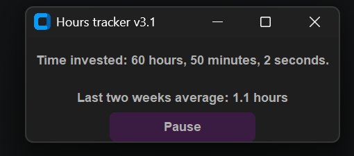
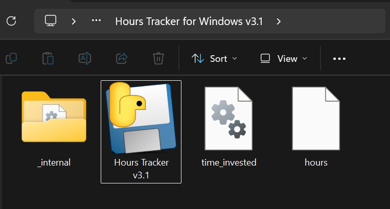

# Hours tracker in Python 

This is an hour tracker I made in Python, using customtkinter and SQLite to track hours invested into any long term task while also telling how many hours have you invested in the past 14 days. 
Inspired by Steam's playtime tracker, except this app does average time instead of cumulative.



(It should look like this on the directory)



## Requirements

- Python 3.13.5 or higher

- CustomTkinter


## Features
1. **Easy to use:** You just open it and it starts tracking; and as soon as you close it, it saves to the .txt file and to the database

2. **Lightweight:** It consumes around 20 MB of RAM (can drop to 5 MB when idle) and 0% CPU usage that goes up to 1.0% when updating.

3. **Modifiable:** Since the data is inside a text file alongside the executable, you can change the hours counter by just changing the decimal number inside the file, and the code will change it into hours and minutes. The same applies for the .db file

## How to run?

### Using the executable:

- Download the latest release for your OS and run it.


### Running the script:

- Make sure you have the requirements and then run this command:

```bash
python3 main.py
```


## Future plans:

- None at the moment, but I'm open to suggestions :)